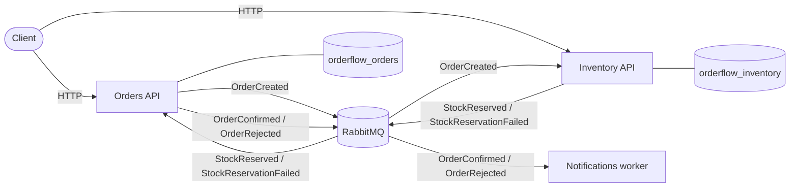
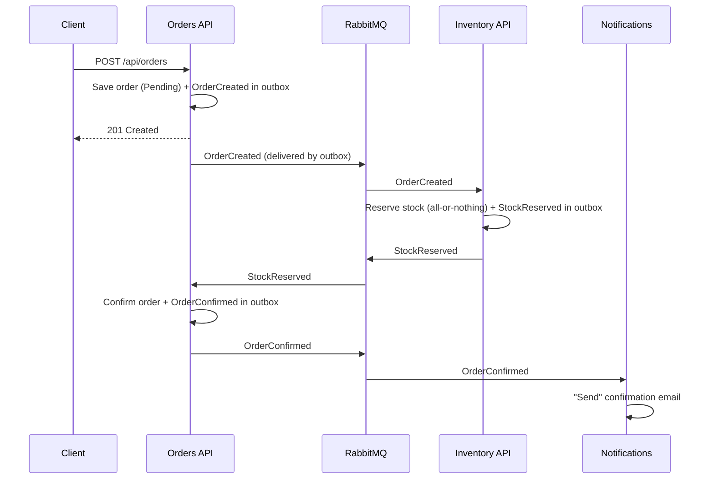

# OrderFlow — event-driven microservices in .NET 10

A small but production-shaped order-processing platform built to show how I design
distributed .NET systems: three services, a message broker, and a database per
service, tied together with an outbox so nothing gets lost between the database
and the broker.

| Service | Responsibility | Port |
| --- | --- | --- |
| **Orders API** | Accepts orders, tracks their lifecycle (`Pending → Confirmed / Rejected / Cancelled`) | `5001` |
| **Inventory API** | Manages stock, reserves it for incoming orders (all-or-nothing) | `5002` |
| **Notifications worker** | Sends (simulated) customer emails on order outcomes | — |
| **RabbitMQ** | Message broker between the services (management UI on `15672`) | `5672` |
| **PostgreSQL** | One container, one database per service | `5432` |

## Architecture



A successful order flows through the system like this:



If any line of the order cannot be fulfilled, Inventory reserves nothing and replies
with `StockReservationFailed`; the order is rejected with the reason and the customer
is notified.

## Design decisions

- **Transactional outbox (MassTransit + EF Core).** Every state change and the events
  describing it commit in the same database transaction. The outbox delivery service
  forwards them to RabbitMQ afterwards, so a crash can never leave "order saved, event
  lost" (or the reverse) behind.
- **Idempotent consumers.** Redelivery is a fact of life with queues. Reservations are
  keyed by `(OrderId, Sku)` with a unique index, and order state transitions are no-ops
  when already applied, so processing a message twice is safe. MassTransit's consumer
  inbox adds a second line of defence.
- **Database per service.** Orders and Inventory each own their schema and migrations;
  they never share tables. The single Postgres container in compose is a convenience,
  not a coupling.
- **Clean Architecture per service.** `Domain → Application → Infrastructure → Api`.
  Handlers depend on an `IEventPublisher` abstraction; MassTransit stays in
  Infrastructure, so the application layer is broker-agnostic and unit-testable.
- **Choreographed saga.** No central orchestrator: each service reacts to events and
  emits its own, keeping the flow explicit in the contracts project.
- **Retries with backoff.** Consumers retry transient failures (exponential backoff,
  5 attempts) before messages land in the error queue, visible in the RabbitMQ UI.
- **Testable transport.** `Transport:Provider = InMemory` swaps RabbitMQ for the
  in-memory bus, which is how the API tests run full end-to-end broker flows in CI
  without Docker.

## Tech stack

.NET 10, ASP.NET Core, EF Core 10, PostgreSQL, RabbitMQ, MassTransit (outbox + retries),
MediatR, FluentValidation, xUnit, Docker Compose, GitHub Actions.

## Run it

Everything, with one command (Docker only, nothing else to install):

```bash
docker compose up --build
```

Then try the flow:

```bash
# Seed some stock
curl -X POST http://localhost:5002/api/stock \
  -H 'Content-Type: application/json' \
  -d '{"sku":"KB-01","name":"Mechanical keyboard","initialQuantity":5}'

# Place an order (201, status Pending)
curl -X POST http://localhost:5001/api/orders \
  -H 'Content-Type: application/json' \
  -d '{"customerEmail":"ada@example.com","lines":[{"sku":"KB-01","quantity":2,"unitPrice":129.99}]}'

# A moment later the order is Confirmed
curl http://localhost:5001/api/orders/<id>

# Order more than exists to watch the rejection path
curl -X POST http://localhost:5001/api/orders \
  -H 'Content-Type: application/json' \
  -d '{"customerEmail":"ada@example.com","lines":[{"sku":"KB-01","quantity":99,"unitPrice":129.99}]}'
```

Useful endpoints while it runs:

- Orders API: `http://localhost:5001/swagger`, health at `/health`
- Inventory API: `http://localhost:5002/swagger`, health at `/health`
- RabbitMQ management: `http://localhost:15672` (`orderflow` / `orderflow`) — watch the
  queues and the outbox traffic in real time
- Notifications: `docker compose logs -f notifications` shows the "emails"

## Run the tests

```bash
dotnet test
```

40+ tests, no Docker required: domain behaviour, application handlers against SQLite,
validators, and full broker round-trips through the real MassTransit pipeline on the
in-memory transport (publish an event, watch the order change state through the API).

## Repository layout

```
src/
  OrderFlow.Contracts/                 Integration events shared across services
  OrderFlow.Orders.{Domain,Application,Infrastructure,Api}
  OrderFlow.Inventory.{Domain,Application,Infrastructure,Api}
  OrderFlow.Notifications.Worker/
tests/
  OrderFlow.Orders.Domain.Tests
  OrderFlow.Orders.Application.Tests
  OrderFlow.Orders.Api.Tests           End-to-end over the in-memory bus
  OrderFlow.Inventory.Application.Tests
  OrderFlow.Inventory.Api.Tests        End-to-end over the in-memory bus
docker-compose.yml                     The whole platform, one command
```

## CI

Every push and PR builds the solution, runs the full test suite with coverage, and
builds all three Docker images (`.github/workflows/ci.yml`).

## License

MIT
